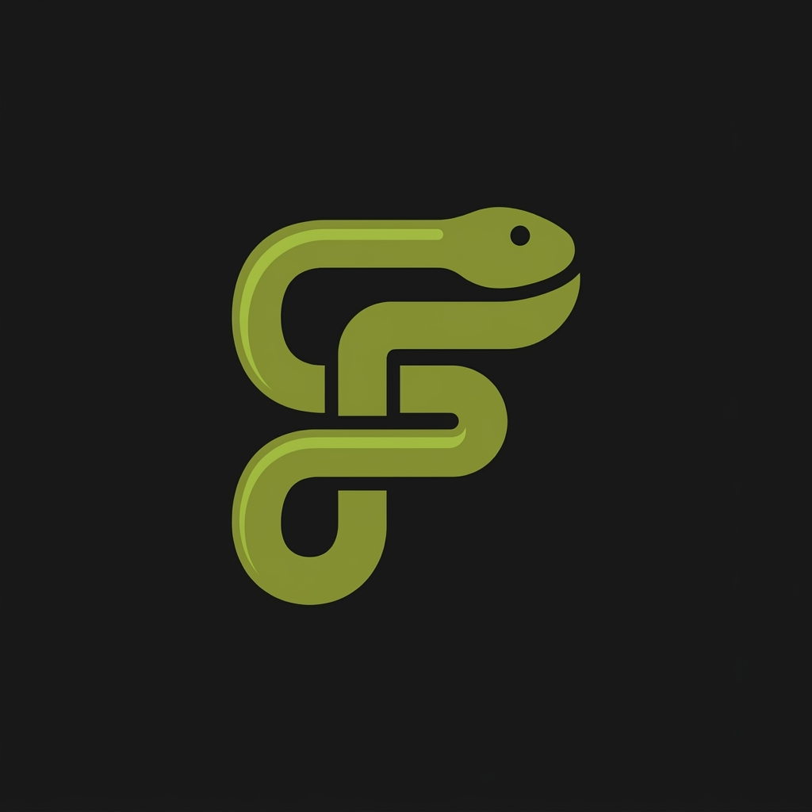

<p align="center"></p>

```

 ▄▄▄▄▄▄                             ▀▀█     ▄▄▄▄    ▄               █    ▀
 █       ▄▄▄    ▄ ▄▄  ▄▄▄▄▄   ▄▄▄     █    █▀   ▀ ▄▄█▄▄  ▄   ▄   ▄▄▄█  ▄▄▄     ▄▄▄
 █▄▄▄▄▄ █▀ ▀█   █▀  ▀ █ █ █  ▀   █    █    ▀█▄▄▄    █    █   █  █▀ ▀█    █    █▀ ▀█
 █      █   █   █     █ █ █  ▄▀▀▀█    █        ▀█   █    █   █  █   █    █    █   █
 █      ▀█▄█▀   █     █ █ █  ▀▄▄▀█    ▀▄▄  ▀▄▄▄█▀   ▀▄▄  ▀▄▄▀█  ▀█▄██  ▄▄█▄▄  ▀█▄█▀
```

Open source software by [FormalSnake](https://github.com/FormalSnake). We
build native desktop apps and an operating system you assemble from the Linux
distro you already like, all declared in code.

## FormalOS

Pick a distro, apply your config, and every machine you own ends up the same.

| Project | What it is | Status |
|---|---|---|
| [FormalSpec](https://github.com/FormalStudio/formalspec) | Declare your machines in Starlark, pin every version in one lockfile, and keep Linux and macOS hosts identical. Switch distros without a USB stick | Early |
| [FormalSpec installer](https://github.com/FormalStudio/formalspec) | A bootable ISO that installs Fedora, Bazzite, Arch, CachyOS, Ubuntu, Debian, openSUSE, Void or AerynOS with a preset, or restores your machines from a git repo | In progress |
| [FormalShell](https://github.com/FormalStudio/FormalShell) | A desktop shell for Hyprland in Rust: bar, launcher, panels, notifications, lock screen and greeter, coloured from your wallpaper | Pre-alpha |
| [formalos-website](https://github.com/FormalStudio/formalos-website) | The site at [os.formalsnake.dev](https://os.formalsnake.dev) | Live |

## Native apps

Built on NativeDesktop, so each app looks like it belongs on the platform it runs on.

| Project | What it is |
|---|---|
| [NativeDesktop](https://github.com/FormalStudio/NativeDesktop) | A Rust toolkit for desktop apps. You describe a window once, and it renders with AppKit on macOS and GPUI on Linux, Windows and the web. Docs at [native.formalsnake.dev](https://native.formalsnake.dev) |
| [Lynk](https://github.com/FormalStudio/lynk-browser) | A keyboard-first browser for macOS and Linux: Chromium through CEF with native chrome |
| [Messages](https://github.com/FormalStudio/messages) | iMessage on Linux and Windows, through a BlueBubbles server on your Mac |
| [FormalMusic](https://github.com/FormalStudio/formalmusic) | YouTube Music for Linux, with its own playback daemon |

## Contributing

Each repo has its own README with build steps. Open an issue before you start on a large change, so we can agree on the approach first.
